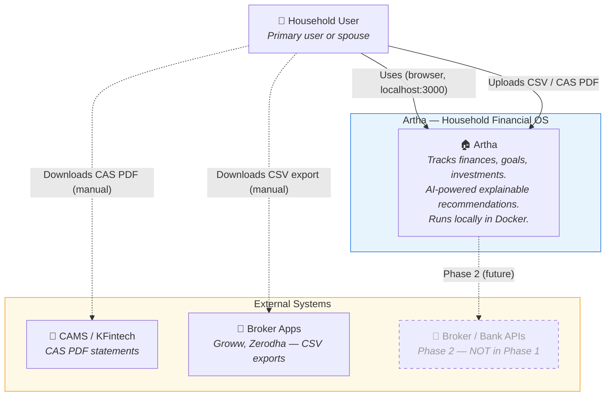
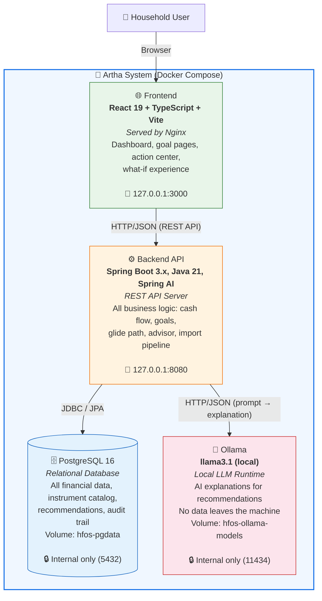
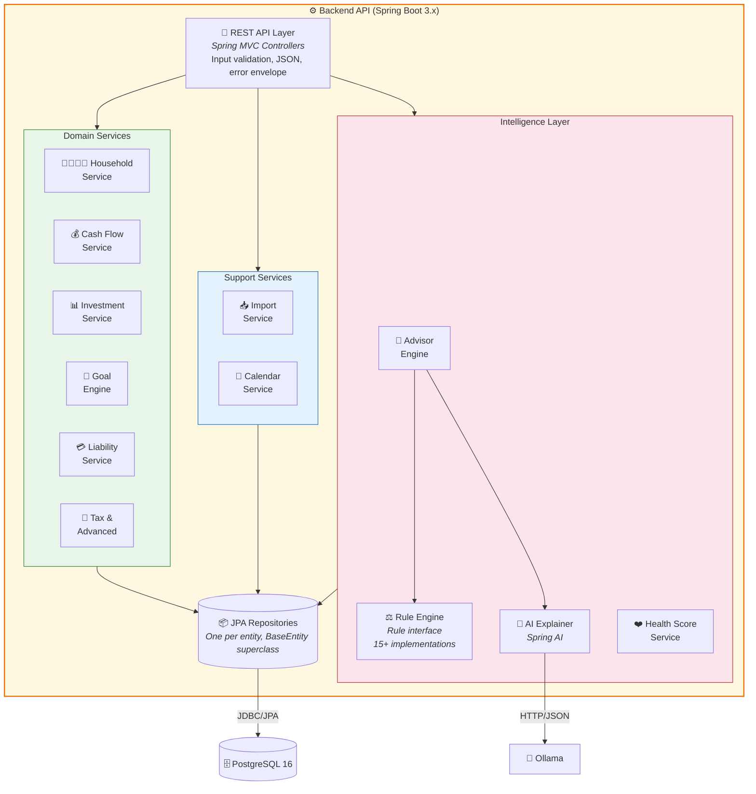
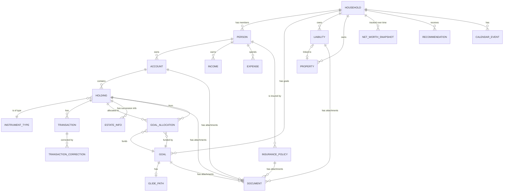
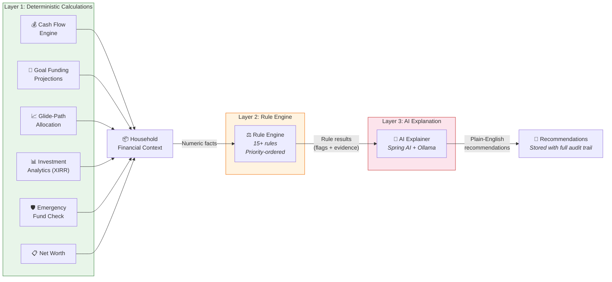
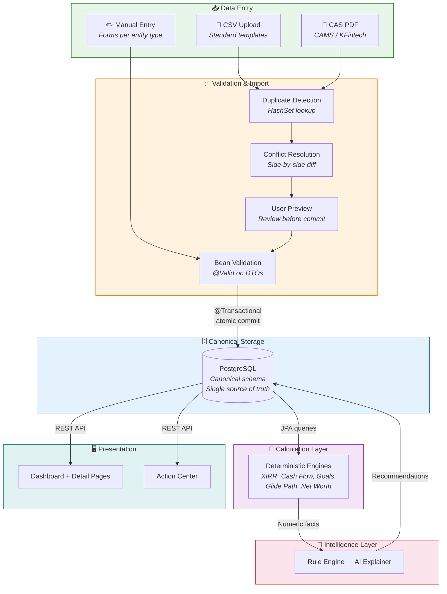
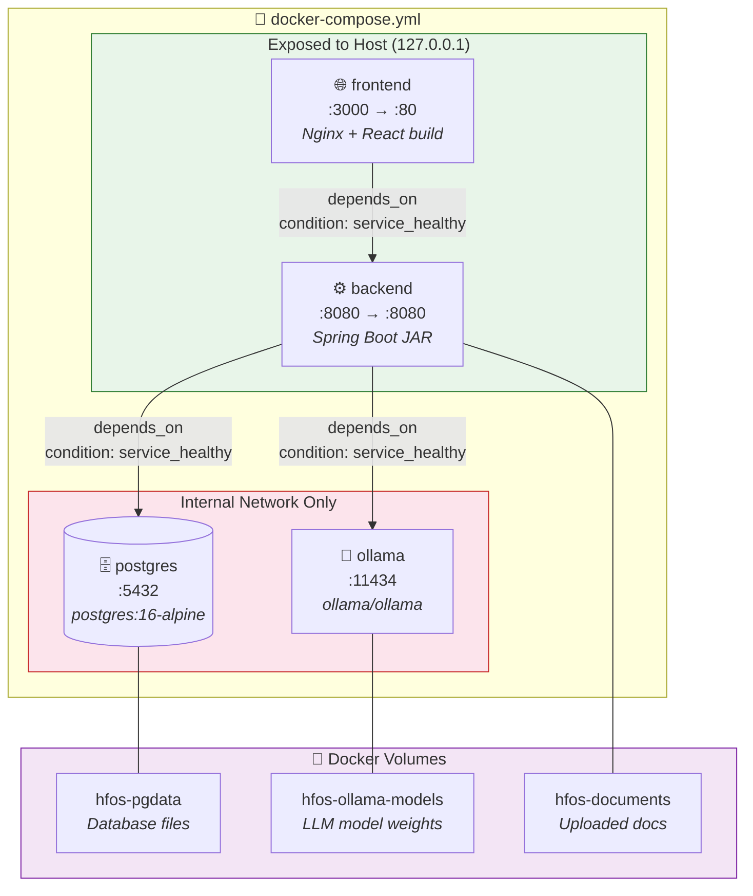

# Artha — Design Document

**Version:** 1.0
**Status:** Draft
**Date:** 2026-10-17
**Spec Reference:** [SPEC-v1.md](SPEC-v1.md) (v1.1)
**Audience:** Development team + Management

---

## Table of Contents

1. [Overview](#1-overview)
2. [Background & Context](#2-background--context)
3. [Goals & Non-Goals](#3-goals--non-goals)
4. [Architecture — C4 Level 1: System Context](#4-architecture--c4-level-1-system-context)
5. [Architecture — C4 Level 2: Container](#5-architecture--c4-level-2-container)
6. [Architecture — C4 Level 3: Component](#6-architecture--c4-level-3-component)
7. [Detailed Design: Data Model (C4 Level 4)](#7-detailed-design-data-model-c4-level-4)
8. [Detailed Design: Algorithms & Complexity](#8-detailed-design-algorithms--complexity)
9. [Detailed Design: Advisor Pipeline](#9-detailed-design-advisor-pipeline)
10. [Detailed Design: Data Flow](#10-detailed-design-data-flow)
11. [Detailed Design: API Design](#11-detailed-design-api-design)
12. [Detailed Design: Resilience & Error Handling](#12-detailed-design-resilience--error-handling)
13. [Infrastructure & Deployment](#13-infrastructure--deployment)
14. [Security](#14-security)
15. [Observability](#15-observability)
16. [Decisions Log](#16-decisions-log)
17. [Open Questions](#17-open-questions)
18. [Appendix](#18-appendix)

---

## 1. Overview

**Artha** (Sanskrit: *wealth, purpose*) is a household financial operating system that gives an Indian family one place to understand their complete financial picture: what they have, what they owe, where they are going, whether they are on track, and what they should do next.

Phase 1 delivers a **local-first, single-user web application** running entirely in Docker Compose on the user's machine. The system combines:

- A **normalized financial data model** covering household members, accounts, holdings across 23 instrument types (mutual funds, stocks, EPF, PPF, NPS, FDs, gold, bonds, crypto, ESOPs, and more), liabilities, goals, and portfolios *(per FR-1.x through FR-8.x)*.
- **Deterministic calculation engines** for cash flow, XIRR, CAGR, goal projections, glide-path allocation, and rebalancing — all using `BigDecimal` precision with no floating-point currency math *(per NFR-1.1, NFR-1.2)*.
- A **layered advisor** that chains deterministic math → a Java rule engine → an AI explainer (Spring AI + Ollama running locally) to produce traceable, explainable recommendations *(per FR-7.1)*.
- A **React dashboard** with goal pages, portfolio pages, an action center, a financial timeline, what-if scenarios, and a financial calendar *(per UX-1.x)*.
- **Data import** via manual entry, CSV templates, and basic CAS PDF parsing — with zero dependency on any broker or bank API *(per FR-8.x, NFR-4.1)*.

The core design principle: **deterministic, auditable financial intelligence with AI that explains but never invents.**

### Technology Stack Summary

| Layer | Technology | Version |
|---|---|---|
| Backend | Spring Boot + Spring AI | 3.x, Java 21 LTS |
| Frontend | Vite + React + TypeScript | React 19, TS 5.x |
| Database | PostgreSQL | 16 |
| LLM | Ollama (local) | Latest |
| Containerization | Docker Compose | v2 |

---

## 2. Background & Context

### The Problem

Indian households typically manage finances across a fragmented landscape:

| Where Money Lives | How It's Tracked Today |
|---|---|
| Mutual funds (Groww, Zerodha, direct AMC) | Each broker's app shows only its own holdings |
| EPF / PPF / NPS | Government portals, PDF statements |
| FDs / RDs (multiple banks) | Bank apps, passbooks |
| Stocks | Demat account apps |
| Gold (physical, SGB, ETF) | Spreadsheets, memory |
| Insurance (term, health, vehicle) | Policy documents, renewal emails |
| Loans (home, car, personal) | Bank statements |
| Goals (retirement, education, house) | Mental model, maybe a spreadsheet |

**The result:** No household-level view. No unified goal tracking. No cross-instrument analytics. No consolidated tax picture. Financial decisions are made in isolation — the retirement portfolio doesn't know about the education goal's timeline, the insurance coverage isn't evaluated before recommending new investments, and spouse-owned assets aren't distinguished from transferred assets for tax purposes.

### Current State

Most households rely on:
- **Broker apps** (Groww, Zerodha) — limited to that broker's instruments, no goal mapping, no glide paths.
- **Spreadsheets** — manual, error-prone, no calculations, no advisor logic.
- **Financial planners** — expensive, periodic, no real-time visibility.
- **Aggregator apps** (INDmoney, ET Money) — cloud-dependent, limited customization, no ownership/source-of-funds tracking, no offline capability.

### Why Artha

Artha fills the gap with a **self-hosted, privacy-first** system that:
1. Runs entirely on the user's machine — no financial data leaves the device *(per NFR-3.1)*.
2. Treats the **household** as the unit, not the individual — spouse, children, parents, and dependents are first-class entities *(per FR-1.1, FR-1.2)*.
3. Tracks **legal ownership, source of funds, and beneficiaries** as distinct concepts — critical for Indian tax compliance *(per FR-1.3, FR-1.5)*.
4. Uses **deterministic math** as the source of truth, with AI that explains but never invents *(per NFR-5.2)*.
5. Supports **23 instrument types** from day 1, with a pluggable catalog for future additions *(per FR-3.1)*.

---

## 3. Goals & Non-Goals

### Goals (Phase 1)

| # | Goal | Spec Reference |
|---|---|---|
| G-1 | A user can create a household, members, accounts, assets, liabilities, and goals without external data integrations | FR-1.x, FR-3.x, FR-4.x, FR-5.x |
| G-2 | A user can record income, expenses, investments, and EMIs and receive correct monthly cash-flow and net-worth calculations | FR-2.x, FR-5.3 |
| G-3 | A user can create retirement, child education, and house goals with target dates, inflation, and step-ups | FR-4.1, FR-4.2 |
| G-4 | The system calculates goal funding status, required contributions, projected outcomes, and glide-path recommendations | FR-4.2, FR-4.3, FR-4.4 |
| G-5 | The system supports ownership / source-of-funds / beneficiary distinctions and produces basic tax flags | FR-1.3, FR-1.5, FR-6.1 |
| G-6 | The dashboard shows overall financial status with navigation to goals and portfolios | UX-1.1 through UX-1.7 |
| G-7 | The advisor produces explainable, traceable recommendations and records user decisions | FR-7.1, FR-7.2, NFR-5.1 |
| G-8 | All major calculations have automated tests and the family acceptance scenario passes | AC-9, IT-01 |

### Non-Goals (Explicitly Out of Scope)

| # | Non-Goal | Deferred To |
|---|---|---|
| NG-1 | Live data connections (broker APIs, bank APIs, MF Central) | Phase 2 |
| NG-2 | LLM-powered flexible import (any CSV format → auto-mapping) | Phase 2 |
| NG-3 | Multi-tenant SaaS with user authentication | Phase 3 |
| NG-4 | OAuth2 / OIDC / MFA authentication | Phase 3 |
| NG-5 | Mobile app (React Native / Flutter) | Phase 3+ |
| NG-6 | Commercial compliance, SEBI regulatory analysis | Phase 3 |
| NG-7 | Monte Carlo simulation for scenario analysis | Phase 2+ (deterministic only in Phase 1) |
| NG-8 | Corporate actions for stocks (splits, bonuses, F&O) | Phase 2+ |
| NG-9 | Redis caching layer | Future (when performance requires it) |
| NG-10 | Cloud deployment (AWS/GCP) | Phase 3 |

### Phase Roadmap (Context Only — Not Designed Here)

```
Phase 1A+1B (this design) ──► Phase 2 (Data Connectivity) ──► Phase 3 (SaaS)
  Local Docker app              Broker/bank APIs                Multi-tenant cloud
  Manual + CSV + CAS            LLM-powered import              Auth, billing, compliance
  Single household              Account Aggregator              Multiple households
```

---

<!-- Sections 4–18 will be drafted in subsequent batches -->

## 4. Architecture — C4 Level 1: System Context

> **🎓 C4 Level 1 answers:** *"What is this system, who uses it, and what does it interact with?"*
> This is the zoomed-out view — Artha is a single box. Think of this as the Google Maps city view.

### 4.1 System Context Diagram



### 4.2 Context Explanation

| Element | Type | Description | Spec Ref |
|---|---|---|---|
| **Household User** | Person | Primary user or spouse. Manages household finances, enters data, creates goals, accepts/rejects recommendations. | FR-1.1, Sec 4 |
| **Artha** | System (this design) | The complete system — backend, frontend, database, LLM — all running locally in Docker Compose. | All FRs |
| **CAMS / KFintech** | External System | Mutual fund registrars. Users manually download CAS PDF statements and upload to Artha for parsing. | FR-8.3 |
| **Broker Apps** | External System | Groww, Zerodha, etc. Users manually export CSV files and upload to Artha. | FR-8.2, NFR-4.1 |
| **Broker / Bank APIs** | External System (future) | Phase 2 scope — live API connections to brokers, banks, MF Central. Greyed out in this diagram because it's NOT in Phase 1. | NG-1 |

**Key insight for Level 1:** Artha has **no live external dependencies** in Phase 1. All data enters via the user (manual entry, file upload). This is by design — privacy-first *(per NFR-3.1)*.

---

## 5. Architecture — C4 Level 2: Container

> **🎓 C4 Level 2 answers:** *"What are the separately running processes/services inside the Artha system?"*
> Now we open the Artha box and see Docker containers. Think of this as the Google Maps street view.

### 5.1 Container Diagram



### 5.2 Container Details

| Container | Technology | Responsibility | Exposed to Host? | Spec Ref |
|---|---|---|---|---|
| **Frontend** | React 19 + TypeScript + Vite (built), served by Nginx | Renders all UX screens: dashboard, goal detail, portfolio detail, action center, timeline, what-if, calendar. Makes REST API calls to the backend. | ✅ `127.0.0.1:3000` | UX-1.x |
| **Backend API** | Spring Boot 3.x, Java 21 LTS, Spring AI | The core of the system. Hosts: REST API controllers, cash-flow engine, goal/glide-path/rebalancing engines, investment analytics (XIRR/CAGR), advisor pipeline (rules + AI), import pipeline (CSV/CAS), and all JPA repositories. | ✅ `127.0.0.1:8080` | FR-1.x through FR-8.x |
| **PostgreSQL** | PostgreSQL 16 Alpine | Persistent relational data store. All financial data, instrument catalog, recommendations, audit trail. Schema managed by Flyway migrations. Data persisted on Docker volume `hfos-pgdata`. | ❌ Internal only | IR-2, IR-4 |
| **Ollama** | Ollama (llama3.1 model) | Local LLM runtime. The backend sends structured context (calculation results + rule flags) and receives natural-language explanations. Financial data never leaves the machine. Model persisted on volume `hfos-ollama-models`. | ❌ Internal only | IR-3, NFR-3.1 |

### 5.3 Container Communication

```
User ──browser──► Frontend (:3000, Nginx)
                      │
                      │ HTTP/JSON (REST API calls)
                      ▼
                  Backend (:8080, Spring Boot)
                   │              │
          JDBC/JPA │              │ HTTP/JSON
                   ▼              ▼
              PostgreSQL      Ollama
              (:5432)         (:11434)
              internal        internal
```

**Why this topology?**
- **Frontend ↔ Backend separation:** React SPA can be developed independently. API-first design enables Phase 3 mobile app without backend changes.
- **PostgreSQL internal only:** No reason to expose the DB to the host. Backend is the only consumer. Reduces attack surface *(per NFR-8.4)*.
- **Ollama internal only:** Same reasoning. Backend proxies AI requests. The UI never talks to Ollama directly.

---

## 6. Architecture — C4 Level 3: Component

> **🎓 C4 Level 3 answers:** *"What modules/services live inside the Backend container, and how do they interact?"*
> Now we zoom into the Spring Boot backend. Think of this as the Google Maps floor plan.

### 6.1 Component Diagram



### 6.2 Component Inventory

| Component | Responsibility | Key Classes/Interfaces | Spec Ref |
|---|---|---|---|
| **REST API Layer** | HTTP handling, input validation, error formatting | Controllers per domain (e.g., `GoalController`, `HoldingController`). Shared `@ControllerAdvice` for error envelope *(per NFR-9.3)* | NFR-8.1, NFR-9.3 |
| **Household Service** | Household + Person lifecycle, ownership model | `HouseholdService`, `PersonService`. PAN encryption via AES-256 utility. | FR-1.x |
| **Cash Flow Service** | Income, expenses, monthly statement | `CashFlowService`. Computes savings rate, debt-service ratio. All BigDecimal. | FR-2.x |
| **Investment Service** | Accounts, holdings, transactions, analytics | `AccountService`, `HoldingService`, `XirrCalculator`, `CagrCalculator`. `InstrumentTypeHandler` interface *(AD-3)* with one implementation per instrument type. | FR-3.x, AD-3 |
| **Goal Engine** | Goals, funding, glide-path, rebalancing, allocation | `GoalService`, `FundingProjectionEngine`, `GlidePathEngine`, `RebalancingEngine`, `GoalAllocationService` | FR-4.x |
| **Liability Service** | Debts, emergency fund, net worth | `LiabilityService`, `EmergencyFundCalculator`, `NetWorthEngine` | FR-5.x |
| **Tax & Advanced** | Tax, insurance, property, scenarios | `TaxService`, `InsuranceService`, `PropertyService`, `ScenarioEngine` | FR-6.x |
| **Advisor Engine** | Orchestrates the 3-layer pipeline | `AdvisorService` — calls calculation services → `RuleEngine` → `AiExplainerService`. Manages `Recommendation` entities. | FR-7.1 |
| **Rule Engine** | Evaluates conditions, produces flags | `Rule` interface *(AD-1)*: `evaluate(HouseholdFinancialContext) → List<RuleResult>`. 15+ implementations auto-discovered as Spring beans. Priority order per Sec 14.2 of spec. | FR-7.1, AD-1 |
| **AI Explainer** | Translates rule results into plain English | `AiExplainerService` using Spring AI `ChatClient`. Sends structured prompt with numeric evidence. Validates output doesn't contradict deterministic results *(per NFR-5.2)*. | NFR-5.2, FR-7.1 |
| **Import Service** | CSV/CAS parsing, conflict resolution | `CsvImportService`, `CasPdfParserService`, `ImportConflictResolver`. Atomic commit via `@Transactional` *(per NFR-7.1)*. | FR-8.x, NFR-7.1 |
| **Health Score Service** | 7 sub-scores (0–100 each) | `HealthScoreService`. Aggregates results from other services. | FR-7.3 |
| **Calendar Service** | Financial event aggregation | `CalendarService`. Queries across goals, liabilities, insurance, holdings for upcoming dates. | FR-7.4 |
| **JPA Repositories** | Data access | One `JpaRepository<Entity, UUID>` per entity *(AD-4)*. Shared `BaseEntity` *(AD-2)* with id, createdAt, updatedAt. | AD-2, AD-4 |

### 6.3 Service Grouping Rationale *(per AD-5)*

The spec has 35 FRs across 8 groups. Rather than one service per FR (too many) or one service per entity (too granular), we group by **domain concern** — resulting in ~12 services:

| Domain | Services | Why Grouped |
|---|---|---|
| Household & Identity | `HouseholdService`, `PersonService` | Tightly coupled — person doesn't exist without household |
| Cash Flow | `CashFlowService` (handles income + expenses + computation) | Income and expenses are two sides of the same cash-flow coin |
| Investments | `AccountService`, `HoldingService`, `XirrCalculator`, `CagrCalculator` | Account → Holding is a composition. Calculators are stateless utilities. |
| Goals | `GoalService`, `FundingProjectionEngine`, `GlidePathEngine`, `RebalancingEngine` | Deeply interdependent — funding needs glide-path, rebalancing needs both |
| Intelligence | `AdvisorService`, `RuleEngine` (interface), `AiExplainerService`, `HealthScoreService` | Advisor orchestrates rules and AI — natural boundary |
| Import | `CsvImportService`, `CasPdfParserService`, `ImportConflictResolver` | All import concerns in one place — parse, validate, conflict, commit |

---

## 7. Detailed Design: Data Model (C4 Level 4)

> **🎓 C4 Level 4 answers:** *"What are the key data structures — entities, their fields, and how they relate?"*
> This is the wiring diagram — every table, every relationship, every foreign key.

### 7.1 Entity Relationship Diagram



### 7.2 Entity Catalog

Every entity extends `BaseEntity` *(AD-2)* which provides: `id` (UUID, PK), `created_at` (timestamp), `updated_at` (timestamp).

#### Core Entities

| Entity | Table Name | Key Fields | Relationships | Spec Ref |
|---|---|---|---|---|
| **Household** | `household` | name, description, status | → many Person, Goal, Liability, Property, Recommendation, CalendarEvent, NetWorthSnapshot | FR-1.1 |
| **Person** | `person` | name, relationship (enum), date_of_birth, gender, pan_encrypted, tax_regime (OLD/NEW), residency_status, citizenship | → Household (FK), → many Account, Income, Expense, InsurancePolicy | FR-1.2 |
| **Account** | `account` | institution_name, account_number_masked, account_type (enum), currency (ISO 4217, default INR), status (ACTIVE/CLOSED) | → Person (FK, owner), → many Holding | FR-3.2 |
| **InstrumentType** | `instrument_type` | code (unique), display_name, asset_class, tax_treatment_json, valuation_method, maturity_rules_json, liquidity_profile, required_fields_json, optional_fields_json | — (reference table, no FK) | FR-3.1 |
| **Holding** | `holding` | name, units, acquisition_cost_total, acquisition_cost_per_unit, acquisition_date, current_value, valuation_date, currency, status (ACTIVE/CLOSED/MATURED), provenance_source, provenance_date, provenance_confidence | → Account (FK), → Person (FK, owner), → InstrumentType (FK), → many Transaction, GoalAllocation, EstateInfo, Document | FR-3.3 |
| **Transaction** | `transaction` | date, amount, type (enum: BUY/SELL/SIP/DIVIDEND/INTEREST/REDEMPTION/SWITCH/BONUS/SPLIT/TRANSFER), units, nav_price, source_of_funds, notes, goal_id (nullable FK) | → Holding (FK), → Person (FK, owner), → Account (FK). **Immutable**: INSERT + SELECT only at DB level. | FR-3.4 |
| **TransactionCorrection** | `transaction_correction` | correction_date, corrected_amount, reason, type (REVERSAL/ADJUSTMENT) | → Transaction (FK, original) | FR-3.4 |

#### Goal & Portfolio Entities

| Entity | Table Name | Key Fields | Relationships | Spec Ref |
|---|---|---|---|---|
| **Goal** | `goal` | name, type (enum: RETIREMENT/CHILD_EDUCATION/HOUSE/EMERGENCY_FUND/CUSTOM), target_date, target_amount_today, inflation_rate, expected_return_rate, priority (CRITICAL/IMPORTANT/ASPIRATIONAL), status (ACTIVE/ACHIEVED/ABANDONED), sip_step_up_pct | → Household (FK), → Person (FK, beneficiary), → Person (FK, owner/funder), → GlidePath, → many GoalAllocation | FR-4.1 |
| **GlidePath** | `glide_path` | type (DATE_BASED/AGE_BASED), schedule_json (array of {years_to_goal or age, equity_pct, safe_pct}) | → Goal (FK, one-to-one) | FR-4.3 |
| **GoalAllocation** | `goal_allocation` | allocation_percentage | → Goal (FK), → Holding (FK). Composite unique constraint on (goal_id, holding_id). Sum of percentages per holding must equal 100. | FR-4.5 |

#### Liability & Property Entities

| Entity | Table Name | Key Fields | Relationships | Spec Ref |
|---|---|---|---|---|
| **Liability** | `liability` | type (enum: MORTGAGE/PERSONAL_LOAN/CAR_LOAN/CREDIT_CARD/EDUCATION_LOAN/OTHER), lender, principal_outstanding, interest_rate, emi_amount, tenure_start, tenure_end, prepayment_total | → Household (FK), → Property (FK, nullable, for mortgages) | FR-5.1 |
| **Property** | `property` | name, purchase_date, purchase_cost, current_value, monthly_rental_income, monthly_expenses, valuation_date | → Household (FK), → Liability (reverse FK for mortgage), → many Goal (via GoalAllocation on linked holdings) | FR-6.3 |

#### Cash Flow Entities

| Entity | Table Name | Key Fields | Relationships | Spec Ref |
|---|---|---|---|---|
| **Income** | `income` | type (enum: SALARY/RENTAL/INTEREST/DIVIDEND/BONUS/BUSINESS/CAPITAL_GAINS/OTHER), amount, frequency (MONTHLY/QUARTERLY/ANNUAL/ONE_TIME), start_date, end_date, source_description | → Person (FK, owner) | FR-2.1 |
| **Expense** | `expense` | category, amount, frequency, is_consumption (boolean), is_recurring (boolean), owner_description | → Person (FK, owner) | FR-2.2 |

#### Intelligence & Support Entities

| Entity | Table Name | Key Fields | Relationships | Spec Ref |
|---|---|---|---|---|
| **Recommendation** | `recommendation` | trigger, rule_name, severity (CRITICAL/WARNING/INFO), category, evidence_json, action, expected_impact, downside_risk, ai_explanation, status (PENDING/ACCEPTED/REJECTED/DEFERRED), user_decision, decision_timestamp, spec_version | → Household (FK) | FR-7.2 |
| **InsurancePolicy** | `insurance_policy` | type (TERM_LIFE/HEALTH/PROPERTY/VEHICLE/CRITICAL_ILLNESS), insured_person_id, sum_assured, annual_premium, premium_due_date, start_date, end_date, renewal_status | → Person (FK, insured), → Person (FK, owner) | FR-6.2 |
| **CalendarEvent** | `calendar_event` | type (SIP/EMI/RENEWAL/MATURITY/TAX_DEADLINE/GOAL_REVIEW/CUSTOM), event_date, recurrence (NONE/MONTHLY/QUARTERLY/ANNUAL), description, linked_entity_type, linked_entity_id | → Household (FK) | FR-7.4 |
| **NetWorthSnapshot** | `net_worth_snapshot` | snapshot_date, total_assets, total_liabilities, net_worth, assets_by_class_json, month_over_month_change, year_over_year_change | → Household (FK). Append-only — never updated. | FR-5.3 |
| **EstateInfo** | `estate_info` | nominee_name, joint_holders_json, beneficiary_designation, will_status (INCLUDED/NOT_INCLUDED/NO_WILL) | → Holding (FK) or → Account (FK) | FR-7.5 |
| **Document** | `document` | file_name, file_path, document_type, linked_entity_type, linked_entity_id, date, sensitivity (NORMAL/SENSITIVE/CONFIDENTIAL), source | Polymorphic link via (entity_type + entity_id) | FR-7.6 |
| **CalculationAudit** | `calculation_audit` | calculation_type, input_json, output_json, spec_version, formula_version, duration_ms | — (standalone audit table) | NFR-9.4 |

### 7.3 Key Design Decisions for Data Model

| Decision | Choice | Why | Spec Ref |
|---|---|---|---|
| **Primary keys** | UUID (generated by application) | Avoids sequential ID exposure, portable across environments, no DB sequence contention | AD-2 |
| **Audit columns** | `created_at`, `updated_at` on every entity via `BaseEntity` | Consistent audit trail, `@PrePersist`/`@PreUpdate` JPA hooks | AD-2, NFR-2.1 |
| **Instrument type metadata** | JSONB columns for `tax_treatment`, `maturity_rules`, `required_fields`, `optional_fields` | Each instrument type has different metadata shapes. JSONB avoids 23 separate tables while keeping it queryable. | FR-3.1, NFR-6.1 |
| **Glide-path schedule** | JSONB column on `glide_path` table | Schedule is a variable-length array of (threshold → allocation) entries. JSONB is natural for this. | FR-4.3 |
| **Transaction immutability** | DB-level: app user has INSERT+SELECT only. No UPDATE/DELETE privilege. | Prevents bugs from ever modifying financial history. Corrections go to `transaction_correction` table. | FR-3.4, Review R-1 |
| **Polymorphic document link** | `linked_entity_type` (enum) + `linked_entity_id` (UUID) | Documents attach to any entity type. Avoids N foreign keys. Trade-off: no DB-level referential integrity on the link. | FR-7.6 |
| **Net-worth snapshots** | Separate table, append-only | Time-series data — never update a past snapshot. Enables historical trend charts. | FR-5.3 |
| **GoalAllocation constraint** | Composite unique (goal_id, holding_id) + application-level check: sum(%) per holding = 100 | Prevents duplicate allocations and ensures no double-counting in net worth. | FR-4.5 |
| **PAN encryption** | Application-level AES-256, stored as encrypted bytes in DB | Cannot use DB-level `pgcrypto` easily with JPA. Application-level gives full control. Key from env var. | FR-1.2, NFR-8 |

### 7.4 Database Indexes

| Table | Index | Columns | Type | Why |
|---|---|---|---|---|
| `transaction` | `idx_txn_holding_date` | (holding_id, date) | B-tree | XIRR calculation scans transactions by holding, ordered by date |
| `transaction` | `idx_txn_account_date` | (account_id, date) | B-tree | Account statement view |
| `transaction` | `idx_txn_goal` | (goal_id) | B-tree | Goal-specific transaction queries (SIP-to-goal mapping) |
| `holding` | `idx_holding_account` | (account_id) | B-tree | Account → holdings lookup |
| `holding` | `idx_holding_owner` | (owner_id) | B-tree | Person → holdings lookup |
| `holding` | `idx_holding_instrument` | (instrument_type_code) | B-tree | Filter holdings by type (e.g., all mutual funds) |
| `goal_allocation` | `idx_ga_holding` | (holding_id) | B-tree | Find all goals a holding is allocated to |
| `goal_allocation` | `idx_ga_goal` | (goal_id) | B-tree | Find all holdings allocated to a goal |
| `income` | `idx_income_person` | (person_id) | B-tree | Cash-flow aggregation by person |
| `expense` | `idx_expense_person` | (person_id) | B-tree | Cash-flow aggregation by person |
| `net_worth_snapshot` | `idx_nw_household_date` | (household_id, snapshot_date) | B-tree | Time-series queries for net-worth chart |
| `recommendation` | `idx_rec_household_status` | (household_id, status) | B-tree | Dashboard: pending recommendations |
| `calendar_event` | `idx_cal_household_date` | (household_id, event_date) | B-tree | Calendar view: upcoming events |

---

## 8. Detailed Design: Algorithms & Complexity

> **🎓 This section answers:** *"What algorithms does Artha use, how do they work, and what is their computational cost?"*
> Every algorithm here is **deterministic** *(per NFR-1.1)* — same inputs, same outputs, every time.

### 8.1 Algorithm Inventory

| # | Algorithm | Used By | Data Structure (Runtime) | Time Complexity | Space Complexity | Spec Ref |
|---|---|---|---|---|---|---|
| A-1 | XIRR (Newton-Raphson) | Investment Analytics | Sorted `List<CashFlow>` | O(n × k) | O(n) | FR-3.6 |
| A-2 | CAGR | Investment Analytics | Two BigDecimal values | O(1) | O(1) | FR-3.6 |
| A-3 | SIP Future Value Projection | Goal Funding Engine | BigDecimal accumulator | O(y) | O(1) | FR-4.2 |
| A-4 | SIP with Annual Step-Up | Goal Funding Engine | BigDecimal accumulator | O(y) | O(1) | FR-4.2 |
| A-5 | Inflation-Adjusted Target | Goal Funding Engine | BigDecimal | O(1) | O(1) | FR-4.2 |
| A-6 | Glide-Path Interpolation | Glide-Path Engine | Sorted schedule array | O(s) | O(s) | FR-4.3 |
| A-7 | Rebalancing Deviation | Rebalancing Engine | Allocation map | O(h) | O(h) | FR-4.4 |
| A-8 | Cash-Flow Aggregation | Cash Flow Service | Stream pipeline | O(i + e) | O(1) streaming | FR-2.3 |
| A-9 | Net-Worth Computation | Net Worth Engine | Parallel streams | O(h + l) | O(1) | FR-5.3 |
| A-10 | Emergency Fund Adequacy | Liability Service | Filter + sum | O(h) | O(1) | FR-5.2 |
| A-11 | Financial Health Score | Health Score Service | 7 sub-score computations | O(total of above) | O(1) per sub-score | FR-7.3 |
| A-12 | Rule Evaluation | Rule Engine | List of Rule beans | O(r × d) | O(r) | FR-7.1 |
| A-13 | Import Duplicate Detection | Import Service | HashSet | O(n) | O(n) | FR-8.2, EC-14 |
| A-14 | Goal Priority Conflict | Goal Engine | Sorted list by priority | O(g log g) | O(g) | FR-4.6 |

**Legend:** n = transactions, k = Newton-Raphson iterations (~10-20), y = years, s = schedule entries (~3-8), h = holdings, l = liabilities, i = income entries, e = expense entries, r = rules (~15-20), d = data points per rule, g = goals.

### 8.2 Algorithm Details

#### A-1: XIRR — Extended Internal Rate of Return

**What it does:** Given a series of cash flows (investments and redemptions) at irregular dates, find the annualized return rate that makes the net present value equal to zero.

**Algorithm:** Newton-Raphson iterative root-finding.

**Pseudocode:**

```
function xirr(cashflows: List<{date, amount}>) -> BigDecimal:
    if cashflows.size < 2:
        return N/A                          // Edge case EC-1

    sort cashflows by date ascending        // O(n log n)
    rate = 0.10                              // Initial guess: 10%

    for iteration = 1 to MAX_ITERATIONS:     // k = 20 max
        npv = 0
        dnpv = 0                             // derivative of NPV

        for each cf in cashflows:            // O(n)
            years = daysBetween(cf.date, cashflows[0].date) / 365.0
            discount = (1 + rate) ^ years
            npv  += cf.amount / discount
            dnpv += -years * cf.amount / discount / (1 + rate)

        if abs(npv) < TOLERANCE:             // TOLERANCE = 1e-7
            return rate

        rate = rate - npv / dnpv             // Newton-Raphson step

    throw CalculationException("XIRR did not converge")
```

**Complexity:**
- **Time:** O(n × k) where n = number of cash flows, k = iterations (typically 10-20). The sort is O(n log n) but dominated by the iteration loop for n > 20.
- **Space:** O(n) for the sorted cash-flow list.
- **Precision:** All intermediate values use `BigDecimal` with 10-decimal scale during computation, result rounded to 6-decimal *(per NFR-1.2)*.

**Edge cases:** Zero transactions → return N/A *(EC-1)*. All cash flows same date → degenerate, return absolute return. Single cash flow → return N/A.

---

#### A-3: SIP Future Value Projection

**What it does:** Project the future value of a monthly SIP at a given expected annual return.

**Formula (no step-up):**

```
FV = PMT × [((1 + r)^n - 1) / r] × (1 + r)

where:
    PMT = monthly SIP amount
    r   = monthly rate = annual_rate / 12
    n   = total months = years × 12
```

**Pseudocode (with annual step-up):**

```
function sipFutureValue(monthlySip, annualReturn, years, stepUpPct) -> BigDecimal:
    monthlyRate = annualReturn / 12
    totalValue = 0
    currentSip = monthlySip

    for year = 1 to years:                   // O(y)
        // Each year's SIP compounds for remaining months
        monthsRemaining = (years - year) * 12 + 12

        for month = 1 to 12:
            // Each month's contribution compounds individually
            totalValue += currentSip × (1 + monthlyRate) ^ monthsRemaining
            monthsRemaining -= 1

        currentSip = currentSip × (1 + stepUpPct)  // Annual step-up

    return totalValue
```

**Complexity:**
- **Time:** O(y × 12) = O(y) where y = years. For a 30-year retirement goal, this is 360 iterations — trivial.
- **Space:** O(1) — single accumulator.
- **Note:** The nested loop (year × 12 months) is still O(y) because months per year is constant (12).

---

#### A-6: Glide-Path Interpolation

**What it does:** Given a schedule of target allocations at specific milestones (years-to-goal or age), compute the target allocation for the current point in time.

**Pseudocode:**

```
function interpolateGlidePath(schedule, currentYearsToGoal) -> Allocation:
    // Schedule is sorted: [{yearsToGoal: 8, equity: 70}, {yearsToGoal: 4, equity: 50}, ...]
    sort schedule by yearsToGoal descending  // O(s log s), s ≈ 3-8

    if currentYearsToGoal >= schedule[0].yearsToGoal:
        return schedule[0].allocation        // Before first milestone

    if currentYearsToGoal <= schedule[last].yearsToGoal:
        return schedule[last].allocation     // Past last milestone (EC-9)

    // Find the two bracketing milestones
    for i = 0 to schedule.size - 2:          // O(s)
        upper = schedule[i]
        lower = schedule[i + 1]

        if currentYearsToGoal <= upper.yearsToGoal
           AND currentYearsToGoal > lower.yearsToGoal:

            // Linear interpolation between milestones
            fraction = (upper.yearsToGoal - currentYearsToGoal)
                     / (upper.yearsToGoal - lower.yearsToGoal)

            targetEquity = upper.equity - fraction × (upper.equity - lower.equity)
            return Allocation(equity = targetEquity, safe = 100 - targetEquity)

    // Should never reach here if schedule is valid
```

**Example (Son's education goal):**

```
Schedule: [{8yr, 70%}, {4yr, 50%}, {1yr, 30%}, {0yr, 20%}]
Current: 6 years to goal

Bracketing: 8yr (70%) and 4yr (50%)
Fraction: (8 - 6) / (8 - 4) = 0.5
Target equity: 70 - 0.5 × (70 - 50) = 60%
→ Target allocation: 60% equity / 40% safe
```

**Complexity:**
- **Time:** O(s) where s = schedule entries (typically 3-8). Trivial.
- **Space:** O(s) for the schedule array.
- **Note:** For s < 10, linear scan beats binary search due to cache locality and no comparison overhead.

---

#### A-7: Rebalancing Deviation Check

**What it does:** Compare actual allocation vs glide-path target for a goal's portfolio. Flag if deviation exceeds threshold.

**Pseudocode:**

```
function checkRebalancing(goalId, threshold = 5%) -> RebalanceResult:
    targetAllocation = glidePathEngine.interpolate(goal)  // O(s)
    holdings = goalAllocationRepo.findByGoalId(goalId)    // DB query

    actualEquity = 0
    actualSafe = 0
    totalValue = 0

    for each allocation in holdings:                       // O(h)
        holdingValue = allocation.holding.currentValue × allocation.percentage / 100
        totalValue += holdingValue

        if allocation.holding.instrumentType.assetClass == EQUITY:
            actualEquity += holdingValue
        else:
            actualSafe += holdingValue

    actualEquityPct = actualEquity / totalValue × 100
    deviation = abs(actualEquityPct - targetAllocation.equityPct)

    if deviation > threshold:
        return RebalanceResult(
            needed = true,
            direction = actualEquityPct > targetAllocation.equityPct ? "REDUCE_EQUITY" : "INCREASE_EQUITY",
            deviationPct = deviation,
            recommendation = "Redirect new SIP to " + underweightClass
        )
    else:
        return RebalanceResult(needed = false)
```

**Complexity:**
- **Time:** O(h) where h = holdings in goal portfolio (typically 3-10).
- **Space:** O(h) for the holdings list.

---

#### A-12: Rule Engine Evaluation

**What it does:** Evaluate all registered financial health rules against the household's current state.

**Pseudocode:**

```
function evaluateRules(householdId) -> List<RuleResult>:
    context = buildContext(householdId)    // O(data loading) — one DB round-trip
    results = []

    // Rules are Spring beans, auto-discovered, sorted by priority
    for each rule in rules:                // O(r), r ≈ 15-20
        if rule.appliesTo(context):        // O(1) — simple condition check
            result = rule.evaluate(context) // O(d) — depends on rule complexity
            results.add(result)

    return results sorted by severity DESC // O(r log r)
```

**Rule interface (Java):**

```java
public sealed interface Rule permits
        GoalAdequacyRule, EmergencyFundRule, DebtManagementRule,
        InsuranceGapRule, AllocationRule, ContributionRule,
        InvestmentSelectionRule, TaxOptimizationRule {

    int priority();
    boolean appliesTo(HouseholdFinancialContext context);
    List<RuleResult> evaluate(HouseholdFinancialContext context);
}
```

**Complexity:**
- **Time:** O(r × d) where r = number of rules (15-20), d = data points per rule evaluation. Most rules are O(1) — simple threshold checks. Some (allocation analysis) are O(h) where h = holdings.
- **Space:** O(r) for the results list.
- **Key insight:** Context is built **once** and shared across all rules. We don't re-query the DB per rule.

---

#### A-13: Import Duplicate Detection

**What it does:** During CSV/CAS import, detect potential duplicates by building a hash set of existing records and checking each imported row.

**Pseudocode:**

```
function detectDuplicates(importedRows, existingTransactions) -> List<DuplicateFlag>:
    // Build hash set of existing records: O(e)
    existingSet = new HashSet<String>()
    for each txn in existingTransactions:
        key = hash(txn.date + "|" + txn.amount + "|" + txn.instrumentCode + "|" + txn.accountId)
        existingSet.add(key)

    // Check each imported row: O(n)
    duplicates = []
    for each row in importedRows:
        key = hash(row.date + "|" + row.amount + "|" + row.instrumentCode + "|" + row.accountId)
        if existingSet.contains(key):       // O(1) hash lookup
            duplicates.add(DuplicateFlag(row, "Potential duplicate of existing record"))

    return duplicates
```

**Complexity:**
- **Time:** O(e + n) where e = existing transactions, n = imported rows. Hash operations are O(1) amortized.
- **Space:** O(e) for the hash set of existing records.
- **Trade-off:** Hash collisions could cause false positives — the user confirms every flagged duplicate before it's skipped.

---

### 8.3 Complexity Summary Table

| Algorithm | Best Case | Typical Case | Worst Case | Dominant Factor |
|---|---|---|---|---|
| XIRR | O(n) — converges in 1 iteration | O(n × 15) | O(n × 20) — near max iterations | n = transactions per holding |
| CAGR | O(1) | O(1) | O(1) | — |
| SIP Projection | O(12) — 1 year | O(360) — 30 years | O(600) — 50 years | y = years |
| Glide-Path | O(1) — before first milestone | O(4) — typical schedule | O(8) — large schedule | s = schedule entries |
| Rebalancing | O(1) — single holding | O(5) — typical goal | O(20) — complex portfolio | h = holdings per goal |
| Cash-Flow Agg | O(1) — no data | O(30) — monthly data | O(100) — detailed data | i + e entries |
| Net Worth | O(1) | O(20) — typical household | O(100) — many holdings | h + l |
| Rule Engine | O(15) — all rules trivial | O(15 × 5) | O(20 × 20) — complex rules | r × d |
| Import Dedup | O(n) — no existing data | O(e + n) | O(e + n) — large import | e = existing, n = imported |
| Goal Priority | O(1) — single goal | O(5 × log 5) | O(20 × log 20) | g = goals |

**Performance conclusion:** For a single household with ~50 holdings, ~5 goals, ~1000 transactions, and ~20 rules — the entire advisor pipeline (all algorithms combined) runs in **< 100ms** on a modern machine. No optimization needed for Phase 1.

---

## 9. Detailed Design: Advisor Pipeline

> **🎓 This section explains the most architecturally significant feature of Artha** — the 3-layer advisor that chains deterministic math → rules → AI explanation.

### 9.1 Pipeline Architecture



### 9.2 Pipeline Execution Flow

```
Step 1: Build Context                                    [O(data loading)]
  └─ Load all household data into HouseholdFinancialContext
  └─ Run all calculation engines → populate numeric facts
  └─ Single DB round-trip using JPA entity graph

Step 2: Evaluate Rules                                   [O(r × d)]
  └─ Iterate rules by priority (1=Goal Adequacy → 8=Tax)
  └─ Each rule checks conditions against context
  └─ Produces: List<RuleResult> with severity, evidence, action

Step 3: AI Explanation (only if rules produced results)   [O(LLM latency)]
  └─ Build structured prompt with:
     - Rule results (which rules fired)
     - Numeric evidence (the exact numbers)
     - Household context (goals, holdings summary)
  └─ Send to Ollama via Spring AI ChatClient
  └─ Validate: AI explanation must not contradict numeric facts
  └─ If Ollama unavailable → fall back to rule descriptions (no AI text)

Step 4: Store Recommendations                            [O(r)]
  └─ Create Recommendation entities with full audit trail
  └─ Include: trigger, evidence, action, AI explanation, spec_version
  └─ Status: PENDING (awaiting user decision)
```

### 9.3 The Context Object

The `HouseholdFinancialContext` is built **once** and shared across all rules and the AI explainer. This avoids re-querying the database per rule.

```java
public record HouseholdFinancialContext(
    // Identity
    Household household,
    List<Person> members,

    // Cash Flow
    CashFlowStatement cashFlow,         // savings rate, debt-service ratio
    BigDecimal freeCashFlow,

    // Goals
    List<GoalProjection> goalProjections, // per goal: funding %, shortfall
    List<GlidePathStatus> glidePathStatuses, // per goal: actual vs target allocation

    // Investments
    List<HoldingWithAnalytics> holdings, // per holding: XIRR, allocation
    Map<String, BigDecimal> assetClassAllocation, // equity: 65%, debt: 30%, gold: 5%

    // Safety
    EmergencyFundStatus emergencyFund,   // months covered, shortfall
    List<InsuranceCoverageGap> insuranceGaps,

    // Liabilities
    List<LiabilitySummary> liabilities,
    BigDecimal debtServiceRatio,

    // Net Worth
    BigDecimal netWorth,
    BigDecimal netWorthChange            // MoM change
) {}
```

### 9.4 AI Prompt Template

The AI explainer sends a structured prompt — not raw data. This ensures the LLM has the right context and guardrails *(per NFR-5.2)*.

```
System: You are a financial advisor assistant for Artha. Your role is to
explain financial recommendations in plain English. Rules:
1. NEVER invent numbers — only use the data provided below.
2. NEVER contradict the rule results — they are the source of truth.
3. Explain WHY the recommendation matters and WHAT happens if the user does nothing.
4. Keep explanations under 200 words.
5. If all rules pass, say "Your finances are on track. No action needed."

Context:
- Household: {household.name}, {members.size} members
- Net worth: ₹{netWorth}, change: {netWorthChange}%
- Free cash flow: ₹{freeCashFlow}/month
- Goals: {goalSummaries}
- Emergency fund: {emergencyFund.monthsCovered} months (target: 6)

Rule Results:
{ruleResults as numbered list with severity, category, evidence}

Generate a prioritized list of recommendations with:
- The action to take
- Why it matters (cite the numbers)
- What happens if they do nothing
```

### 9.5 Advisor Priority Order *(per Spec Sec 14.2)*

| Priority | Category | Rule Class | Fires When |
|---|---|---|---|
| 1 | Goal Adequacy | `GoalAdequacyRule` | Any goal funding < 80% of projected need |
| 2 | Emergency Fund | `EmergencyFundRule` | Months covered < target (default 6) |
| 3 | Debt Management | `DebtManagementRule` | Debt-service ratio > 40% |
| 4 | Insurance Gaps | `InsuranceGapRule` | Term life < 10× income OR health < ₹10L |
| 5 | Asset Allocation | `AllocationDeviationRule` | Equity deviation > threshold (default 5%) from glide-path |
| 6 | Contribution Adequacy | `ContributionAdequacyRule` | Total required SIPs > available free cash flow |
| 7 | Investment Selection | `InvestmentSelectionRule` | Index fund tracking error > 1%, or high TER |
| 8 | Tax Optimization | `TaxOptimizationRule` | Clubbing flag, or harvestable short-term losses |

---

## 10. Detailed Design: Data Flow

> **🎓 This section answers:** *"How does financial data enter the system, get validated, stored, and fed to calculations?"*

### 10.1 Data Flow Diagram



### 10.2 Data Flow Explanation

| Stage | What Happens | Key Principle | Spec Ref |
|---|---|---|---|
| **Entry** | Data enters via 3 paths — all convert to the same canonical DTO format before validation. Manual entry submits DTOs directly. CSV and CAS are parsed into DTOs first. | **Canonical format** — all import paths converge to one schema *(per NFR-4.2)* | FR-8.x |
| **Validation** | Server-side Bean Validation (`@Valid`) checks types, ranges, required fields. Import paths add duplicate detection (HashSet) and conflict resolution (side-by-side diff). | **Validate early, reject clearly** *(per NFR-8.1)* | NFR-8.1, FR-8.4 |
| **Storage** | Validated data is committed to PostgreSQL in a single atomic transaction. Imported batches are all-or-nothing. | **Atomic commits** *(per NFR-7.1)* | NFR-7.1 |
| **Computation** | Calculation engines read from the DB (via JPA) and produce numeric results. Results are deterministic — no external calls, no randomness. | **Deterministic math** *(per NFR-1.1)* | NFR-1.1 |
| **Intelligence** | Rule engine evaluates facts, AI explains results. Recommendations are stored back to DB with full audit trail. | **Calc → Rules → AI layering** *(per FR-7.1)* | FR-7.1 |
| **Presentation** | React frontend fetches data and recommendations via REST API. Dashboard assembles the household financial picture. | **API-first** — frontend is a consumer, not a calculator | UX-1.x |

---

## 11. Detailed Design: API Design

### 11.1 API Conventions

| Convention | Standard | Spec Ref |
|---|---|---|
| **Base path** | `/api/v1/` | — |
| **Format** | JSON (application/json) | — |
| **IDs** | UUID in path: `/api/v1/goals/{goalId}` | AD-2 |
| **Pagination** | `?page=0&size=20` (Spring Data defaults) | — |
| **Sorting** | `?sort=createdAt,desc` | — |
| **Error format** | Consistent JSON envelope *(see 11.3)* | NFR-9.3 |
| **Validation** | Server-side `@Valid` on all request DTOs | NFR-8.1 |
| **Versioning** | URL-based: `/api/v1/`, `/api/v2/` (future) | — |
| **CORS** | `http://localhost:3000` only | NFR-8.2 |
| **Content negotiation** | JSON only (no XML) | — |

### 11.2 Endpoint Groups

| Group | Endpoints | HTTP Methods | Notes |
|---|---|---|---|
| **Household** | `/household`, `/household/{id}/members` | GET, POST, PUT, DELETE | Full CRUD |
| **Cash Flow** | `/income`, `/expenses`, `/cashflow/{householdId}` | CRUD + computed GET | Cash-flow GET is computed, not stored |
| **Investments** | `/accounts`, `/holdings`, `/transactions` | CRUD (transactions: POST + GET only) | Transactions are immutable — no PUT/DELETE |
| **Goals** | `/goals`, `/goals/{id}/projection`, `/goals/{id}/glidepath`, `/goals/{id}/rebalance` | CRUD + computed GETs | Projection/glidepath/rebalance are computed on demand |
| **Liabilities** | `/liabilities`, `/networth/{householdId}` | CRUD + computed GET | |
| **Advanced** | `/insurance`, `/properties`, `/scenario` | CRUD + POST (scenario) | Scenario POST takes variable overrides, returns computed results |
| **Intelligence** | `/advisor/{householdId}`, `/health-score/{householdId}`, `/calendar/{householdId}`, `/recommendations` | GET + decision PUT | Advisor GET triggers full pipeline |
| **Import** | `/import/csv`, `/import/cas` | POST (multipart file upload) | Returns preview → user confirms → commit |
| **Catalog** | `/instrument-types` | GET | Read-only catalog |
| **Health** | `/actuator/health` | GET | Spring Boot Actuator | NFR-9.2 |

### 11.3 Error Response Format *(per NFR-9.3)*

All errors follow this envelope:

```json
{
  "status": 400,
  "error": "VALIDATION_ERROR",
  "message": "Request validation failed",
  "details": [
    { "field": "targetDate", "message": "must be a future date" },
    { "field": "amount", "message": "must be positive" }
  ],
  "timestamp": "2026-10-17T18:30:00Z"
}
```

| HTTP Status | Error Code | When |
|---|---|---|
| 400 | `VALIDATION_ERROR` | Bean Validation fails |
| 404 | `NOT_FOUND` | Entity doesn't exist |
| 409 | `CONFLICT` | Import conflict detected (use conflict resolution flow) |
| 409 | `ALLOCATION_CONFLICT` | Goal allocation doesn't sum to 100% |
| 422 | `IMPORT_PARSE_ERROR` | CSV/CAS file cannot be parsed |
| 500 | `CALCULATION_ERROR` | XIRR didn't converge, unexpected math error |
| 503 | `OLLAMA_UNAVAILABLE` | Ollama container not responding — advisor falls back to rule descriptions |
| 500 | `INTERNAL_ERROR` | Unexpected server error (stack trace logged, not exposed) |

### 11.4 Import API Flow (Multi-Step)

The import process is not a single request — it's a multi-step flow:

```
Step 1: POST /api/v1/import/csv  (multipart file upload)
        → Response: { importId, preview: { rowCount, validRows, errors, duplicates, conflicts } }

Step 2: User reviews preview in frontend

Step 3: POST /api/v1/import/{importId}/resolve
        Body: { resolutions: [{ rowIndex: 3, action: "USE_IMPORTED" }, ...] }
        → Response: { resolvedCount, pendingCount }

Step 4: POST /api/v1/import/{importId}/commit
        → Response: { committed: true, rowsInserted: 45, rowsSkipped: 3 }
        (Atomic transaction — all or nothing)
```

---

## 12. Detailed Design: Resilience & Error Handling

> **🎓 This section covers:** *"What happens when things go wrong? How does the system retry, recover, and stay consistent?"*

### 12.1 Resilience Strategy by Component

| Component | What Can Fail | Retry? | Idempotency | Fallback | Spec Ref |
|---|---|---|---|---|---|
| **Ollama (AI)** | Container down, model loading, slow response | ✅ 3 retries, 2s/4s/8s exponential backoff | ✅ Same prompt + context → cached response (optional) | Skip AI explanation — use rule descriptions as plain-text recommendations | NFR-5.2, FR-7.1 |
| **PostgreSQL** | Connection lost (unlikely on local Docker) | ✅ Spring retry with HikariCP pool recovery | ✅ Inherent — same INSERT with same UUID is rejected (PK constraint) | N/A — system cannot function without DB | — |
| **CSV Import** | Malformed file, partial parse | ❌ No auto-retry — user re-uploads | ✅ Duplicate detection prevents double-import of same data | Clear error with missing column list or parse error location | FR-8.2, EC-4 |
| **CAS PDF Parse** | Unrecognizable format, corrupted file | ❌ No auto-retry — user tries again | ✅ Same as CSV | Suggest manual entry as fallback | FR-8.3, EC-5 |
| **Calculations (XIRR, etc.)** | XIRR non-convergence, division by zero | ❌ No retry — deterministic, will fail again | ✅ Inherent — deterministic = same input, same output | Return `N/A` with explanation, do not error the entire page | EC-1, NFR-1.1 |
| **Goal Allocation** | Percentages don't sum to 100% | ❌ No retry — validation error | ✅ Validation prevents invalid state | 400 error with clear message | FR-4.5 |

### 12.2 Ollama Retry Configuration

```yaml
# application.yml
artha:
  ollama:
    max-retries: 3
    backoff-initial: 2000    # 2 seconds
    backoff-multiplier: 2    # 2s → 4s → 8s
    timeout: 30000           # 30s per request
    fallback-to-rules: true  # If all retries fail, use rule descriptions
```

**Retry logic (pseudocode):**

```
function getAiExplanation(context, ruleResults) -> String:
    for attempt = 1 to MAX_RETRIES:
        try:
            response = springAiClient.call(buildPrompt(context, ruleResults))
            validate(response, ruleResults)   // Check AI doesn't contradict facts
            return response.text
        catch OllamaUnavailableException:
            if attempt < MAX_RETRIES:
                sleep(backoff * multiplier ^ (attempt - 1))
            else:
                log.warn("Ollama unavailable after {} retries, falling back to rules", MAX_RETRIES)
                return buildFallbackText(ruleResults)  // Plain rule descriptions
```

### 12.3 Idempotency Patterns

| Pattern | Where Applied | How It Works |
|---|---|---|
| **Duplicate detection via hash** | CSV/CAS import | Hash set of (date + amount + instrument + account). Same file uploaded twice → duplicates flagged, not double-inserted. *(Algorithm A-13)* |
| **UUID primary keys** | All entities | If the same entity creation is retried (e.g., network glitch on POST), the UUID PK constraint prevents duplicates. The client generates the UUID. |
| **Deterministic calculations** | All engines | XIRR(same transactions) = same result. Running the advisor twice = same recommendations. No side effects from re-running. |
| **Atomic import commit** | CSV/CAS import | The import commit is wrapped in `@Transactional`. If any row fails, no rows are committed. Re-running commit with the same import ID is a no-op (import is marked as committed). |
| **Recommendation dedup** | Advisor engine | Before creating a new recommendation, check if a PENDING recommendation with the same `trigger + rule_name` exists. If so, update rather than duplicate. |

### 12.4 Transaction Boundaries *(per NFR-7.1)*

| Operation | Transaction Scope | Isolation Level | Why |
|---|---|---|---|
| **CSV/CAS import commit** | All imported rows in a single `@Transactional` | READ_COMMITTED | All-or-nothing: if row 45 of 50 fails, none are committed |
| **Goal allocation change** | Old allocations deleted + new ones inserted atomically | READ_COMMITTED | Cannot have a moment where allocations don't sum to 100% |
| **Net-worth snapshot** | SELECT all assets + liabilities + INSERT snapshot in one transaction | REPEATABLE_READ | Snapshot must reflect a consistent point-in-time view |
| **Recommendation lifecycle** | Single recommendation status update | READ_COMMITTED | Simple single-row update |
| **Regular CRUD** | Spring Data default (per-method transaction) | READ_COMMITTED | Standard |

### 12.5 Error Recovery Runbook

| Scenario | Detection | Recovery |
|---|---|---|
| **Ollama container won't start** | Health check `/actuator/health` shows Ollama DOWN | Backend still works — all features except AI explanations. Action center shows rule-based text. Fix: `docker compose restart ollama`. |
| **PostgreSQL volume lost** | Backend fails to start, Flyway can't connect | Restore from backup: `psql -f backups/artha-YYYYMMDD.sql`. If no backup, fresh start with `docker compose down -v && docker compose up`. |
| **Flyway migration fails** | Backend won't start, health check reports migration failure | Check `flyway_schema_history` table. Fix the failing migration SQL. Run `flyway repair` then `flyway migrate`. See README for details. |
| **Import stuck (committed = false)** | Import ID shows `status: PREVIEW` indefinitely | User can abandon and re-upload. Old preview data is cleaned up after 24h (scheduled task). |
| **XIRR won't converge** | Calculation returns N/A | Check transaction data for the holding — likely a data quality issue (e.g., all buys, no current value). Fix the data. |

---

## 13. Infrastructure & Deployment

### 13.1 Docker Compose Topology



### 13.2 Health Checks *(per NFR-9.2)*

| Service | Health Check Command | Interval | Retries | Start Period |
|---|---|---|---|---|
| `postgres` | `pg_isready -U hfos` | 10s | 5 | 30s |
| `backend` | `curl -f http://localhost:8080/actuator/health` | 15s | 3 | 60s (JVM startup) |
| `ollama` | `curl -f http://localhost:11434/api/tags` | 15s | 5 | 120s (model loading) |
| `frontend` | `curl -f http://localhost:80` | 10s | 3 | 15s |

Startup order: **postgres** → **ollama** → **backend** → **frontend** (each waits for the previous to be healthy).

### 13.3 Docker Compose Configuration (Skeleton)

```yaml
# docker-compose.yml
version: "3.9"
services:
  postgres:
    image: postgres:16-alpine
    environment:
      POSTGRES_DB: ${POSTGRES_DB:-hfos}
      POSTGRES_USER: ${POSTGRES_USER:-hfos}
      POSTGRES_PASSWORD: ${POSTGRES_PASSWORD:-hfos_local}
    volumes:
      - hfos-pgdata:/var/lib/postgresql/data
    networks:
      - artha-net
    healthcheck:
      test: ["CMD-SHELL", "pg_isready -U hfos"]
      interval: 10s
      retries: 5
      start_period: 30s

  ollama:
    image: ollama/ollama
    volumes:
      - hfos-ollama-models:/root/.ollama
    networks:
      - artha-net
    healthcheck:
      test: ["CMD-SHELL", "curl -f http://localhost:11434/api/tags || exit 1"]
      interval: 15s
      retries: 5
      start_period: 120s

  backend:
    build: ./backend
    ports:
      - "127.0.0.1:8080:8080"
    env_file: .env
    volumes:
      - hfos-documents:/app/documents
    depends_on:
      postgres:
        condition: service_healthy
      ollama:
        condition: service_healthy
    networks:
      - artha-net
    healthcheck:
      test: ["CMD-SHELL", "curl -f http://localhost:8080/actuator/health || exit 1"]
      interval: 15s
      retries: 3
      start_period: 60s

  frontend:
    build: ./frontend
    ports:
      - "127.0.0.1:3000:80"
    depends_on:
      backend:
        condition: service_healthy
    networks:
      - artha-net
    healthcheck:
      test: ["CMD-SHELL", "curl -f http://localhost:80 || exit 1"]
      interval: 10s
      retries: 3
      start_period: 15s

volumes:
  hfos-pgdata:
  hfos-ollama-models:
  hfos-documents:

networks:
  artha-net:
    driver: bridge
```

### 13.4 Project Directory Structure

```
artha/
├── docker-compose.yml
├── .env.example                    # Placeholder config (committed)
├── .env                            # Actual config (gitignored)
├── .gitignore
├── README.md
│
├── backend/                        # Spring Boot application
│   ├── Dockerfile
│   ├── build.gradle.kts
│   ├── src/main/java/com/artha/
│   │   ├── ArthaApplication.java
│   │   ├── config/                 # Spring config, CORS, Security
│   │   ├── domain/                 # JPA entities (BaseEntity, Household, Person, ...)
│   │   ├── repository/             # Spring Data JPA repositories
│   │   ├── service/                # Domain services (CashFlowService, GoalEngine, ...)
│   │   ├── engine/                 # Calculation engines (XirrCalculator, GlidePathEngine, ...)
│   │   ├── advisor/                # AdvisorService, Rule interface, AI explainer
│   │   │   ├── rules/              # Rule implementations (15+ files)
│   │   │   └── ai/                 # Spring AI Ollama integration
│   │   ├── import_/                # Import services (CSV, CAS PDF, conflict resolver)
│   │   ├── controller/             # REST API controllers
│   │   └── dto/                    # Java records for request/response DTOs
│   ├── src/main/resources/
│   │   ├── application.yml
│   │   ├── db/migration/           # Flyway SQL migrations (V1__init.sql, ...)
│   │   └── csv-templates/          # Downloadable CSV template files
│   └── src/test/java/com/artha/
│       ├── unit/                   # Unit tests (UT-01 through UT-21)
│       ├── integration/            # Integration tests with Testcontainers (IT-01 through IT-09)
│       └── fixtures/               # Test fixtures (family acceptance scenario data)
│
├── frontend/                       # React application
│   ├── Dockerfile
│   ├── nginx.conf
│   ├── package.json
│   ├── vite.config.ts
│   ├── src/
│   │   ├── App.tsx
│   │   ├── api/                    # API client (fetch wrappers)
│   │   ├── components/             # Shared UI components
│   │   ├── pages/                  # Dashboard, GoalDetail, Portfolio, ActionCenter, ...
│   │   ├── hooks/                  # Custom React hooks
│   │   └── types/                  # TypeScript interfaces matching backend DTOs
│   └── src/__tests__/              # Vitest + RTL tests (FT-01 through FT-06)
│
├── scripts/
│   └── backup.sh                   # pg_dump to ./backups/
│
├── backups/                        # Database backup files (gitignored)
│
└── docs/
    ├── SPEC-v1.md
    ├── Artha-Design-Document.md
    └── SDLC-STATE.md
```

### 13.5 Backup & Restore *(per NFR-7.2)*

**Backup:**
```bash
# scripts/backup.sh
#!/bin/bash
TIMESTAMP=$(date +%Y%m%d-%H%M%S)
docker exec artha-postgres-1 pg_dump -U hfos hfos > ./backups/artha-${TIMESTAMP}.sql
echo "Backup saved: ./backups/artha-${TIMESTAMP}.sql"
```

**Restore:**
```bash
cat ./backups/artha-YYYYMMDD-HHMMSS.sql | docker exec -i artha-postgres-1 psql -U hfos hfos
```

---

## 14. Security

### 14.1 Security Architecture (Phase 1)

| Layer | Mechanism | Spec Ref |
|---|---|---|
| **Network** | All ports bound to `127.0.0.1` only. PostgreSQL and Ollama not exposed to host. Docker bridge network isolates services. | NFR-8.4 |
| **Authentication** | None in Phase 1 (single-user local app). Full OAuth2/OIDC in Phase 3. | NFR-3.2 |
| **Input Validation** | Bean Validation (`@Valid`) on all API request DTOs. JPA parameterized queries prevent SQL injection. React JSX escaping prevents XSS. | NFR-8.1 |
| **CORS** | Restricted to `http://localhost:3000`. No wildcard origins. Configurable via `CORS_ALLOWED_ORIGINS` env var. | NFR-8.2 |
| **PII Protection** | PAN numbers encrypted at rest (AES-256, application-level). Masked in API responses (`ABCD****4F`). Never in logs. | FR-1.2, NFR-8 |
| **Document Sensitivity** | Sensitive/Confidential documents excluded from list API unless `includeSensitive=true`. No file paths in logs. Storage directory: permissions 700. | NFR-8.5 |
| **Credentials** | `.env` file in `.gitignore`. `.env.example` committed. No secrets in Docker image or source code. | NFR-8.3 |
| **Data Privacy** | Ollama runs locally — financial data never sent to external APIs. No telemetry, no analytics, no third-party calls. | NFR-3.1 |

### 14.2 PAN Encryption Detail

```java
@Component
public class PanEncryptor {
    private final SecretKey key;  // Loaded from PAN_ENCRYPTION_KEY env var

    public String encrypt(String pan) {
        // AES-256/GCM encryption
        // Returns Base64-encoded ciphertext
    }

    public String decrypt(String encryptedPan) {
        // Decrypts for internal use (tax calculations)
        // Never exposed to API responses
    }

    public String mask(String pan) {
        // "ABCDE1234F" → "ABCD****4F"
        // Used in all API responses and UI
    }
}
```

---

## 15. Observability

### 15.1 Logging *(per NFR-9.1)*

| What | Log Content | Level |
|---|---|---|
| **API Requests** | Endpoint, method, duration (ms), status code, request ID | INFO |
| **Calculations** | Calculation type, input hash, duration, output summary | DEBUG |
| **AI Calls** | Prompt token count, response time, model name, success/failure | INFO |
| **Rule Evaluation** | Rules fired, severity counts, total evaluation time | INFO |
| **Import** | File name, row count, duplicates found, conflicts, committed rows | INFO |
| **Errors** | Full stack trace (server-side only, never in API response) | ERROR |

**Configuration:**
```yaml
# application.yml
logging:
  level:
    root: ${LOG_LEVEL:INFO}
    com.artha: DEBUG
    org.hibernate.SQL: WARN
  pattern:
    console: '{"timestamp":"%d","level":"%p","logger":"%logger","message":"%m","requestId":"%X{requestId}"}%n'
```

### 15.2 Health Endpoint Detail *(per NFR-9.2)*

`GET /actuator/health` returns:

```json
{
  "status": "UP",
  "components": {
    "db": { "status": "UP", "details": { "database": "PostgreSQL", "version": "16.x" } },
    "flyway": { "status": "UP", "details": { "pending": 0, "applied": 12 } },
    "ollama": { "status": "UP", "details": { "model": "llama3.1", "responseTimeMs": 45 } },
    "diskSpace": { "status": "UP", "details": { "free": "45GB" } }
  }
}
```

When Ollama is down:
```json
{
  "status": "UP",
  "components": {
    "db": { "status": "UP" },
    "ollama": { "status": "DOWN", "details": { "error": "Connection refused" } }
  }
}
```

**Note:** Overall status is still `UP` when Ollama is down — the system is functional (advisor falls back to rule descriptions). Only PostgreSQL DOWN makes overall status `DOWN`.

### 15.3 Calculation Audit Trail *(per NFR-9.4)*

Every major calculation stores an audit record:

```json
{
  "calculationType": "XIRR",
  "inputHash": "sha256:abc123...",
  "input": { "holdingId": "uuid", "transactionCount": 24, "dateRange": "2024-01-15 to 2026-10-15" },
  "output": { "xirr": 0.142300 },
  "specVersion": "SPEC-v1.1",
  "formulaVersion": "newton-raphson-v1",
  "durationMs": 12,
  "timestamp": "2026-10-17T18:30:00Z"
}
```

---

## 16. Decisions Log

| # | Date | Decision | Rationale | Spec Ref |
|---|---|---|---|---|
| 1 | 2026-10-17 | Spring Boot 3.x + Java 21 LTS | User is a Java developer; Spring AI for LLM; enterprise ecosystem | Grill: Tech |
| 2 | 2026-10-17 | React 19 + Vite + TypeScript | Fast dev, modern React, type safety for financial UIs | Grill: Frontend |
| 3 | 2026-10-17 | PostgreSQL 16 over SQLite/MongoDB | Relational integrity for financial data; scales to Phase 3 SaaS | Grill: Data Store |
| 4 | 2026-10-17 | JPA/Hibernate + Flyway | Type-safe entities + versioned migrations from day 1 | Grill: Schema |
| 5 | 2026-10-17 | Ollama (local) over cloud LLMs | Financial data privacy; no API costs; swappable later | Grill: LLM |
| 6 | 2026-10-17 | Deterministic math + AI explanation | Product principle: AI explains but never invents calculations | Grill: Calc |
| 7 | 2026-10-17 | Hybrid glide-path (date + age) | Date-based for education; age-based for retirement | Grill: Glide Path |
| 8 | 2026-10-17 | SIP-to-goal primary + virtual allocation fallback | Covers new SIPs (clean) and legacy holdings (flexible) | Grill: Holding Split |
| 9 | 2026-10-17 | Pluggable instrument type catalog (23 types) | Users pick what they own; new types via DB, not code | Grill: Instruments |
| 10 | 2026-10-17 | Single-user, no auth (Phase 1) | Local Docker app; full auth in Phase 3 | Grill: Auth |
| 11 | 2026-10-17 | `Rule` interface for advisor rules (AD-1) | 15+ rules, common pattern, Spring auto-discovery | AD-1 |
| 12 | 2026-10-17 | `BaseEntity` superclass (AD-2) | 21 entities share id/timestamps; avoids boilerplate | AD-2 |
| 13 | 2026-10-17 | `InstrumentTypeHandler` strategy (AD-3) | 23 types, each with distinct tax/valuation logic | AD-3 |
| 14 | 2026-10-17 | No interfaces for calculators (AD-7) | Single implementation each — KISS over SOLID | AD-7 |
| 15 | 2026-10-17 | No event sourcing (AD-8) | Immutable table sufficient — no ES infrastructure needed | AD-8 |
| 16 | 2026-10-17 | No CQRS (AD-9) | Single-user, single DB — standard MVC suffices | AD-9 |
| 17 | 2026-10-17 | C4 model for architecture documentation | User learning architecture; structured zoom levels | Design Doc Phase |
| 18 | 2026-10-17 | Mermaid diagrams (standard flowchart syntax) | Git-tracked, renders in markdown preview | Design Doc Phase |
| 19 | 2026-10-17 | Newton-Raphson for XIRR | Industry standard; converges in ~15 iterations for financial data | Algorithm A-1 |
| 20 | 2026-10-17 | Exponential backoff for Ollama retries | Gives local LLM time to recover; 3 attempts max | Resilience |
| 21 | 2026-10-17 | HashSet for import duplicate detection | O(1) per-record lookup; acceptable memory for household-scale data | Algorithm A-13 |

---

## 17. Open Questions

| # | Question | Owner | Status |
|---|---|---|---|
| 1 | Which specific Ollama model to use? (llama3.1 8B vs 70B vs other) — depends on user's hardware RAM. | User | ❓ Open — decide at build time |
| 2 | CAS PDF format specifics — CAMS and KFintech use different layouts. Need sample PDFs to build parser. | Dev | ❓ Open — need sample files |
| 3 | Tax rules versioning — how to handle when Indian tax rules change annually (e.g., LTCG threshold changes in budget). | Dev + User | ❓ Open — design versioned config in Batch 5 |
| 4 | Frontend charting library — Recharts vs Chart.js vs Nivo for goal projections, allocation pie charts, net-worth trend. | Dev | ❓ Open — decide in Batch 8 (UX) |

---

## 18. Appendix

### 18.1 Glossary

| Term | Definition |
|---|---|
| **XIRR** | Extended Internal Rate of Return — annualized return for irregular cash flows |
| **CAGR** | Compound Annual Growth Rate — smoothed return over a period |
| **SIP** | Systematic Investment Plan — recurring monthly investment |
| **CAS** | Consolidated Account Statement — combined MF statement from CAMS/KFintech |
| **NAV** | Net Asset Value — price per unit of a mutual fund |
| **TER** | Total Expense Ratio — annual cost of a mutual fund |
| **AUM** | Assets Under Management — total money managed by a fund |
| **Glide Path** | Gradual shift in asset allocation as a goal date approaches |
| **Clubbing** | Indian tax concept: income from transferred assets taxed in transferor's hands |
| **LTCG** | Long-Term Capital Gains |
| **STCG** | Short-Term Capital Gains |
| **EEE** | Exempt-Exempt-Exempt tax status (investment, growth, and withdrawal all tax-free) |
| **PAN** | Permanent Account Number — Indian tax ID |

### 18.2 Spec Cross-Reference

This design document traces to SPEC-v1.md (v1.1). Every section references specific spec IDs:

| Design Doc Section | Spec Sections |
|---|---|
| 4. C4 Context | FR-1.1, FR-8.x, NFR-4.1 |
| 5. C4 Container | IR-1 through IR-8, NFR-8.4 |
| 6. C4 Component | AD-1 through AD-6, all FR groups |
| 7. Data Model | FR-1.x through FR-8.x, requirements Sec 5 |
| 8. Algorithms | FR-3.6, FR-4.2, FR-4.3, FR-4.4, NFR-1.1 |
| 9. Advisor Pipeline | FR-7.1, FR-7.2, NFR-5.1, NFR-5.2 |
| 10. Data Flow | FR-8.x, NFR-4.2, NFR-7.1 |
| 11. API Design | Spec Sec 9, NFR-8.1, NFR-8.2, NFR-9.3 |
| 12. Resilience | NFR-7.1, NFR-7.4, EC-1 through EC-14 |
| 13. Infrastructure | IR-1 through IR-8, NFR-9.2 |
| 14. Security | NFR-3.x, NFR-8.x |
| 15. Observability | NFR-9.x, NFR-2.x |

---

*End of Artha Design Document*
